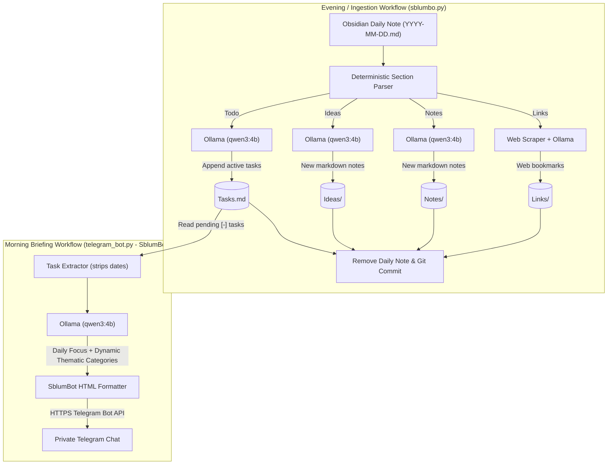

# Sblumbo 🧠🗂️

An automated, zero-dependency Python toolchain for your **Obsidian Vault** powered by local LLMs (**Ollama**). It consists of two complementary workflows:

1. **Sblumbo (`sblumbo.py`)**: Daily Note ingestion that extracts, enriches, and triages tasks, notes, ideas, and web links into your Vault with an automatic Git commit.
2. **SblumBot (`telegram_bot.py`)**: A morning assistant that reviews remaining tasks, generates a calm daily focus summary, dynamically groups tasks into thematic categories with emojis, and delivers a private briefing to your Telegram.

---

## 🔄 System Architecture & Workflow



---

## ✨ Features

Starting from an Obsidian Daily Note structured across 4 sections (`Todo`, `Ideas`, `Notes`, `Links`):

1. **📝 Todo** → Extracts atomic actionable items (splitting compound tasks) and appends them to `Tasks.md` in the format `- [ ] Action #YYYY-MM-DD`. Includes a deterministic fallback ensuring no tasks are dropped.
2. **💡 Ideas** → Processes each idea item, generates a concise title, YAML frontmatter tags, and clean Markdown with wikilinks, saving each file in `Ideas/`.
3. **📦 Notes** → Formats each note faithfully without hallucinating unstated facts, generating clean titles, tags, and wikilinks in `Notes/`.
4. **🔗 Links** → Extracts URLs (even with surrounding notes or grouping subtitles), scrapes `<title>` and `<meta description>` from the webpage, translates/summarizes the resource via LLM, and creates a note in `Links/`.
5. **🧹 Cleanup & Git Commit** → If and only if all sections are processed successfully without errors or dropped data, removes the ingested Daily Note and makes a Git commit in the Vault with an informative summary (e.g., `Ingest 2026-11-02 at 19:30:00 — 3 todos, 1 idea, 2 notes, 4 links`).

---

## 📁 Project Structure

```text
sblumbo/
├── sblumbo.py              # Main CLI entry point and fail-safe orchestration
├── telegram_bot.py         # SblumBot: Telegram morning task briefing worker
├── .env                    # Local configuration (ignored by Git)
├── .env.example            # Configuration template
├── .gitignore              # Git ignore rules
├── README.md               # Project documentation
├── tests/
│   ├── test_worker.py      # Sblumbo edge-case test suite
│   └── test_telegram_bot.py # SblumBot Telegram briefing test suite
└── worker/                 # Core package modules
    ├── __init__.py         # Public package exports
    ├── config.py           # Zero-dependency .env loader and Config dataclass
    ├── parser.py           # Deterministic parser for Daily Note sections and lists
    ├── prompts.py          # Anti-hallucination system prompts and JSON schemas
    ├── ollama_client.py    # HTTP client for Ollama and pre-flight health-check
    ├── scraper.py          # HTML metadata scraper (<title>, OpenGraph, description)
    ├── processors.py       # Section processors, anti-collision, and YAML sanitization
    ├── telegram.py         # Telegram message formatting, task extraction & API dispatch
    └── git_utils.py        # Vault validation, note resolution, and safe Git commits
```

---

## ⚙️ Configuration (`.env`)

Copy the `.env.example` file to `.env` and adjust the variables for your setup:

```bash
cp .env.example .env
```

| Variable             | Default                           | Description                                                             |
| :------------------- | :-------------------------------- | :---------------------------------------------------------------------- |
| `VAULT_PATH`         | `~/Obsidian`                      | Absolute path or `~` to the root of your Obsidian Vault.                |
| `TODO_FILE`          | `Tasks.md`                        | Target file for tasks (relative to `VAULT_PATH` or absolute).           |
| `NOTES_DIR`          | `Notes`                           | Target directory for notes (relative to `VAULT_PATH` or absolute).      |
| `IDEAS_DIR`          | `Ideas`                           | Target directory for ideas (relative to `VAULT_PATH` or absolute).      |
| `LINKS_DIR`          | `Links`                           | Target directory for links (relative to `VAULT_PATH` or absolute).      |
| `DAILY_DIR`          | `Daily`                           | Directory containing Daily Notes.                                       |
| `OLLAMA_URL`         | `http://127.0.0.1:11434/api/chat` | Ollama chat API endpoint.                                               |
| `OLLAMA_MODEL`       | `qwen3:4b`                        | Ollama model to use (supports standard and thinking models).            |
| `OLLAMA_TIMEOUT`     | `300`                             | Maximum timeout in seconds per Ollama request.                          |
| `OLLAMA_TEMPERATURE` | `0.1`                             | Model temperature (lower values minimize hallucinations).               |
| `OLLAMA_NUM_PREDICT` | `512`                             | Maximum number of tokens generated per call.                            |
| `OLLAMA_THINK`       | `false`                           | Disable/enable thinking traces for reasoning models (e.g., `qwen3:4b`). |
| `URL_FETCH_TIMEOUT`  | `6`                               | Timeout in seconds for webpage metadata scraping.                       |
| `GIT_AUTO_COMMIT`    | `true`                            | If `true`, automatically commits changes to the Vault after ingestion.  |
| `TELEGRAM_BOT_TOKEN` | `""`                              | Telegram Bot API token for SblumBot notifications.                      |
| `TELEGRAM_CHAT_ID`   | `""`                              | Telegram Chat ID where morning briefings are delivered.                 |

---

## 🤖 SblumBot: Telegram Morning Briefing (`telegram_bot.py`)

A standalone morning worker that reviews all pending, unchecked tasks from `Tasks.md`, asks Qwen to produce a calm daily focus summary, dynamically categorizes tasks with contextual emojis, and delivers an HTML-formatted briefing to your Telegram chat.

### Key Highlights

- **Dynamic Context-Aware Categorization**: The LLM analyzes the semantic meaning of your tasks on the fly and groups them into relevant categories (e.g. 💊 _Health & Pharmacy_, 💻 _Tech & Automation_, 🛒 _Errands_, 💼 _Work_). No empty buckets or rigid predefined schemas.
- **Calm, Clutter-Free Presentation**: Uses a clean notebook (`📓`) header, strips `#YYYY-MM-DD` date tags from task lines, avoids artificial urgency indicators (`⚡`), and eliminates redundant metadata for quick reading.
- **Safe HTML & Automatic Chunking**: Dynamically sanitizes text against HTML injection and splits messages exceeding Telegram's 4,096-character limit into clean parts.

### Message Preview Example

```text
📓 SblumBot — Morning Briefing

💡 Today's Focus:
Panoramica tranquilla della giornata: configurazione delle notifiche Telegram e ritiro dei farmaci in farmacia.

💊 Salute & Farmacia
• ritirare sensori in farmacia borgo
• ritirare eliquis in farmacia borgo

💻 Tech & Automazioni
• Configura bot Telegram per inviare notifiche da Obsidian al mattino
```

### Usage

```bash
# Preview briefing in terminal without sending to Telegram
python3 telegram_bot.py --dry-run

# Run and send morning briefing to Telegram
python3 telegram_bot.py

# Skip Ollama recap and send categorized task list directly
python3 telegram_bot.py --no-ai

# Silent mode: do nothing if all tasks are completed
python3 telegram_bot.py --quiet-if-empty
```

---

## 🚀 Sblumbo: Daily Note Ingestion Usage

Sblumbo requires no external Python packages (runs on standard Python 3.10+). Ensure `ollama` is running and the configured model is pulled (`ollama pull qwen3:4b`).

### 1. Run with an explicit path

```bash
python3 sblumbo.py ~/Obsidian/Daily/2026-11-02.md
```

### 2. Quick run (date only or today's note)

If omitted, Sblumbo automatically looks for today's note (`YYYY-MM-DD.md`) in `DAILY_DIR`:

```bash
# Automatically finds ~/Obsidian/Daily/<TODAY>.md
python3 sblumbo.py

# Or pass just the date:
python3 sblumbo.py 2026-11-02
```

_(Note: `python3 obsidian_worker.py ...` also remains available as an alias)._

### 3. CLI options and preview mode (`--dry-run`)

Inspect how sections are parsed **without** querying Ollama and **without** modifying any files:

```bash
python3 sblumbo.py 2026-11-02 --dry-run
```

Additional flags:

- `--keep-daily`: Ingests the note without deleting the original Daily Note.
- `--no-commit`: Processes the note but skips Git commit in the Vault.
- `--env-file /path/to/custom.env`: Use an alternative `.env` configuration file.

---

## 🧪 Testing (Edge Cases)

The project includes an automated test suite in `tests/test_worker.py` (built on standard library `unittest`, requiring no external dependencies or active Ollama instance).

```bash
# Run all tests with verbose output
python3 -m unittest discover -s tests -v

# Run only SblumBot Telegram tests
python3 -m unittest tests/test_telegram_bot.py -v

# Run only Sblumbo ingestion tests
python3 -m unittest tests/test_worker.py -v
```

---

## 📝 Expected Daily Note Format

The parser recognizes headings regardless of emoji spacing or heading depth (`#`, `##`, `###`, `####`):

```markdown
### 📝 Todo

- Migrate notes from Keep
- Set up automated backup

### 💡 Ideas

- Build a home energy consumption monitoring dashboard

### 📦 Notes

- 1-hour team meeting regarding the project team
- Quick command to check listening ports with ss -tulpn

### 🔗 Links

- https://github.com/raspberrypi/rpi-image-gen
- serfsrl.it - Official air filtration website
```

---

## 🛡️ Fail-Safes and Data Protection

Sblumbo incorporates safety guarantees to prevent data loss or model hallucinations:

1. **Deterministic Task Fallback**:
   - If an LLM returns an empty task list or drops user tasks on single-line or short bullet points, a deterministic fallback ensures all original lines are preserved in `Tasks.md`.
2. **Empty Category Isolation**:
   - Empty sections or lines with only whitespace/empty bullets (`* `, `- [ ]`, `[x]`) are discarded upfront before querying the LLM, preventing hallucinated instructions.
3. **Non-destructive Ingest Safeguard**:
   - If any section with content fails to produce output or encounters an error, the original Daily Note is **never deleted**.
4. **Git Safe Staging**:
   - Staging distinguishes existing files from deleted files (`git rm --ignore-unmatch`), preventing Git exit code 128 when untracked notes are removed.
5. **Vault & Index Protection**:
   - Validates that `VAULT_PATH` exists, is a directory, and has read/write permissions.
   - Prevents accidental ingestion or deletion of folder index files (such as `Daily/Daily.md`).
6. **Pre-flight Ollama Health Check**:
   - Confirms that the Ollama daemon is reachable and the required model is pulled before performing any file operations.
7. **File Collision Avoidance & YAML Sanitization**:
   - Duplicate titles generate incremental filenames (`Note_2.md`) rather than overwriting existing notes.
   - Frontmatter strings and tags are sanitized to ensure valid Obsidian YAML syntax.
   - Syncthing versioning directories (`.stversions`, `.stfolder`) are automatically kept in `.gitignore`.
